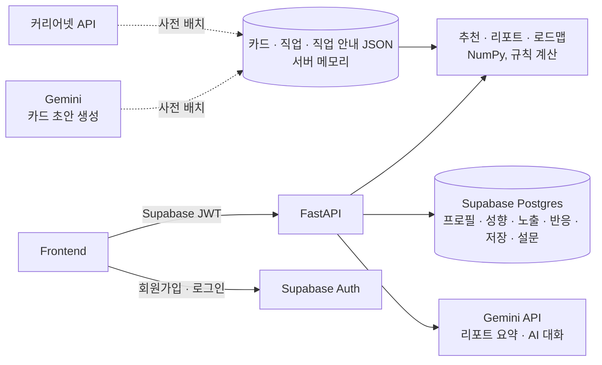

# WOOWANGTHON_TEAM_50_BE

**FIND-ME** 백엔드 — 진로를 정하지 못한 중학생이 하루 30초 카드 반응만으로 자기 진로 성향을 쌓아가는 AI 진로 탐색 서비스

> 2026 AI 우왕톤 · 주제 "AI는 동료가 될 수 있을까?" · 팀 50
>
> 배포: https://findme-api-rxg3.onrender.com (API 문서 `/docs`) · Render 무료 플랜이라 15분 동안 요청이 없으면 잠들고, 첫 요청에 50초쯤 걸린다.

---

## 1. 백엔드가 하는 일

| 기능 | 설명 |
|---|---|
| 관심사 설문 | 가입 직후 12문항(흥미 유형마다 2문항, 5점 척도) 답으로 흥미 점수를 처음 채움 |
| 카드 피드 | 사용자 성향 벡터와 가까운 카드를 추천하고, 20%는 다른 분야 카드를 섞어서 내려줌 |
| 반응 수집 | 끌려요 · 별로예요 · 패스 · 선택지 고르기를 노출 로그와 함께 저장하고 성향 벡터를 갱신 |
| 저장 | 카드 북마크. 반응과 별개라 성향에 반영하지 않고 언제든 취소 가능 |
| 성향 리포트 | 흥미 유형 · 방식/가치 · 어울리는 직업 · 관련 학과 · 공부 팁 (점수 계산) + 요약 문장 (Gemini) |
| 직업 로드맵 | 저장한 직업마다 지금 해 볼 일 → 키워 볼 능력 → 진학 준비 → 자격과 진출 (커리어넷 원문) |
| 여정 | 연속 접속 · 오늘 목표(5장) · 레벨 · 성향 유형 · 오늘의 미션 · 배지 |
| 직업 탐색 · AI 대화 | 성향과 맞는 직업 목록·상세, 직업 질문 답변과 진로 대화 (Gemini, 실패 시 자료 기반 답) |

회원가입·로그인은 프론트에서 Supabase Auth로 처리하고, 백엔드는 요청에 담긴 Supabase JWT를 검증한다. 가입 후 입력받는 사용자 정보(프로필)는 백엔드가 `profiles` 테이블에 저장한다.

## 2. 기술 스택

| 영역 | 기술 |
|---|---|
| 프레임워크 | FastAPI, Pydantic |
| 추천 계산 | NumPy |
| DB · 인증 | Supabase (Postgres, Auth · JWKS) |
| LLM | Gemini API (`google-genai`, 기본 모델 `gemini-3.8-flash`) |
| 콘텐츠 원천 | 커리어넷 Open API (직업백과) |
| 배포 | Render (`render.yaml`) |

## 3. 구조



- **사용자가 만드는 데이터**(프로필, 성향 벡터, 노출, 반응, 저장, 설문 답)는 Supabase에 저장한다.
- **팀이 만드는 데이터**(차원 정의, 직업, 직업 안내, 카드)는 레포의 JSON/CSV로 관리하고, 서버가 시작할 때 Pydantic으로 검증한 뒤 메모리에 올린다. 검증에 실패하면 서버가 뜨지 않는다.
- 외부 API 키와 Supabase service role 키는 백엔드에만 둔다. DB는 RLS를 켜고 정책을 두지 않아 백엔드(service role) 외에는 접근할 수 없다.

## 4. 추천 방식

카드와 사용자를 **같은 11차원 공간**의 벡터로 표현하고, 코사인 유사도로 가까운 카드를 고른다.

- **차원:** Holland RIASEC 흥미 6축 + 일하는 방식·가치관 5축. 정의는 [`backend/data/attributes.csv`](backend/data/attributes.csv), 태깅 기준은 [`docs/dimensions.md`](docs/dimensions.md)
- **카드 벡터:** 0~3 정수 루브릭으로 태깅. 카드당 0이 아닌 축 2~4개
- **사용자 벡터:** 반응 가중치(끌려요 1.0 · 선택 1.0 · 별로예요 −0.5 · 패스 0)를 곱해 지수이동평균으로 갱신. 선택형 카드는 고른 선택지의 벡터를 사용. 관심사 설문은 답마다 흥미 축을 ±0.125씩 바꾼다
- **콜드 스타트:** 반응이 5개 미만이거나 벡터가 0이면 **전체 카드에서 완전 무작위**로 뽑는다 (분야 구분 없음). 관심사 설문은 반응 수에 들어가지 않으므로, 설문을 해도 처음 5개 반응까지는 무작위다
- **맞춤 + 탐색:** 그 뒤로는 코사인 유사도 순으로 뽑고, 20%는 무작위 카드로 섞는다. 이 카드는 맞춤 결과에 없는 분야를 먼저, 분야별로 돌아가며 고른다. 첫 장은 항상 맞춤 카드
- **노출 관리:** 이미 반응한 카드는 다시 보여 주지 않고, 받았지만 반응하지 않은 카드는 다음 피드에 같은 노출로 다시 내려준다

노출 로그에는 추천 출처(`personalized` / `random` / `cold_start`)를 함께 저장해 **맞춤 추천과 무작위 추천의 반응률을 비교**한다 → [`supabase/queries/source_reaction_rates.sql`](supabase/queries/source_reaction_rates.sql)

## 5. 디렉터리

```
.
├─ backend/
│  ├─ app/
│  │  ├─ main.py          # 앱 생성, 라우터 등록, 시작 시 콘텐츠 로드·검증
│  │  ├─ core/            # 설정, Supabase JWT 검증
│  │  ├─ api/             # 라우터 (HTTP 계층)
│  │  ├─ content/         # 카드·직업 모델과 로더
│  │  ├─ recommend/       # 벡터 갱신, 랭킹 (DB·HTTP 의존 없음)
│  │  ├─ llm/             # Gemini 호출, 프롬프트 (리포트 요약, AI 대화)
│  │  ├─ db/              # Supabase 접근
│  │  ├─ schemas/         # API 요청/응답 모델
│  │  ├─ report.py · roadmap.py · journey.py · jobs.py · interest_survey.py   # 규칙 계산 (LLM 없음)
│  ├─ data/               # attributes.csv, jobs.json, job_guides.json, cards.json
│  ├─ scripts/            # 커리어넷 수집, 카드 생성·검수, 배포 점검(check_deploy), E2E(e2e)
│  ├─ tests/
│  ├─ .env.example
│  └─ requirements.txt
├─ supabase/
│  ├─ migrations/         # DB 스키마 (5개)
│  └─ queries/            # 분석 쿼리 (맞춤 vs 무작위)
└─ docs/                  # 설계 문서
```

> 진행 상황은 [`docs/backend-checklist.md`](docs/backend-checklist.md) 참고.

## 6. API

`/health`를 빼고 모두 `Authorization: Bearer <Supabase access token>`이 필요하다. 정확한 요청·응답 형식은 `/docs`(Swagger)를 기준으로 한다.

| 메서드 | 경로 | 설명 |
|---|---|---|
| GET | `/health` | 헬스 체크 (카드·직업 수) |
| POST | `/me` | 가입 후 프로필 등록 (이미 있으면 409) |
| GET | `/me` | 내 프로필과 11개 축 성향 점수 (프로필이 없으면 404) |
| PATCH | `/me` | 프로필 수정 |
| GET | `/interest-survey` | 설문을 이미 했는지 (`done`). 다른 브라우저·기기에서 로그인해도 설문을 다시 띄우지 않기 위함 |
| POST | `/interest-survey` | 관심사 설문 12문항 → 흥미 점수 ± 반영. 사용자당 한 번 (다시 보내면 `duplicate`) |
| GET | `/feed?n=10` | 다음에 보여 줄 카드 (출처 `source`, 저장 여부 `saved`, '왜 이 카드?' `reason`) |
| POST | `/reactions` | 반응 저장 + 성향 갱신 (`like` · `dislike` · `pass` · `choose`. `save`는 422) |
| GET | `/me/saved` | 저장한 카드 (최근 순) |
| PUT · DELETE | `/me/saved/{card_id}` | 카드 저장 · 저장 취소 (성향에 반영하지 않음, 둘 다 204) |
| GET | `/me/report` | 성향 리포트 (끌려요·선택 1개부터 열림) |
| GET | `/me/roadmap` | 저장한 직업마다 로드맵 |
| GET | `/me/roadmap/{job_id}` | 직업 하나의 로드맵 (저장 안 한 직업도 미리 보기) |
| GET | `/me/journey` | 홈 화면용 연속 접속 · 오늘 목표 · 레벨 · 성향 유형 · 미션 · 배지 |
| GET | `/jobs` | 내 성향과 잘 맞는 순서의 직업 목록 (`field`로 분야 거르기) |
| GET | `/jobs/{job_id}` | 직업 상세 (적합도, 로드맵 단계, 비슷한 직업, AI에게 물어볼 질문) |
| POST | `/jobs/{job_id}/ask` | 직업에 대한 정해진 질문에 답 (Gemini, 실패 시 자료로 만든 답) |
| POST | `/chat` | AI 진로 동료와 대화 (대화 내용은 저장하지 않음) |

가입 설문은 12문항 관심사 설문(`POST /interest-survey`) 하나만 쓴다. 예전 선택형 카드 5장 설문(`GET /onboarding`)은 FE가 쓰지 않아 삭제했다 (2026-11-13).

## 7. 실행 방법

```bash
cd backend
python -m venv .venv
source .venv/bin/activate          # Windows: .venv\Scripts\activate
pip install -r requirements.txt
cp .env.example .env               # 값 채우기
uvicorn app.main:app --reload      # http://localhost:8000/docs
```

DB 스키마는 [`supabase/migrations/`](supabase/migrations/)를 파일 이름 순서대로 Supabase SQL Editor에서 실행한다.

### 테스트 · 점검

```bash
python -m pytest                                                   # 자동 테스트 (DB·Gemini는 대역)
python -m scripts.check_deploy --api <서버 주소> --origin <프론트 주소>   # 마이그레이션 5개 · /health · 인증 · CORS
python -m scripts.e2e --api <서버 주소>                              # 실제 DB로 가입 → 설문 → 피드 → 반응 → 저장 → 리포트 → 로드맵
```

`e2e`는 테스트 계정(`e2e-*@example.com`)을 만들어 쓰고 끝나면 지운다.

### 심사위원 · 시연용 계정

```bash
DEMO_PASSWORD=<비밀번호> python -m scripts.seed_demo --api <서버 주소> --email demo-judge@example.com --reset
```

배포 API로 프로필 → 관심사 설문 → 반응 15개(탐구·예술형 학생) → 리포트 추천 직업 3개 저장까지 쌓아서, 로그인하자마자 리포트·로드맵이 열린다. `demo-`로 시작하는 계정은 분석 쿼리에서 빠진다 (스크립트가 만든 반응이라 실제 결과가 아님). 비밀번호는 레포에 넣지 않는다.

### 첫 요청 지연 (Render 무료 플랜)

15분 동안 요청이 없으면 서버가 잠들고, 깨어날 때 첫 요청이 50초쯤 걸린다. [`.github/workflows/keepalive.yml`](.github/workflows/keepalive.yml)이 10분마다 `/health`를 불러 깨워 두지만, GitHub 예약 실행은 늦을 수 있으므로 심사·시연 직전에는 `/health`를 직접 한 번 열어 둔다.

### 환경 변수

| 이름 | 설명 |
|---|---|
| `SUPABASE_URL` | Supabase 프로젝트 URL |
| `SUPABASE_SERVICE_ROLE_KEY` | 서버 전용 키. 프론트·레포에 절대 노출 금지 |
| `GEMINI_API_KEY` | Gemini API 키. 비어 있으면 리포트·AI 대화는 규칙 기반 문장만 쓴다 |
| `GEMINI_MODEL` | 기본 `gemini-3.8-flash` |
| `CORS_ORIGINS` | 허용할 프론트 주소 (쉼표 구분) |
| `CONTENT_REVIEWED_ONLY` | `true`면 검수된 카드만 노출 (검수된 카드가 없으면 서버가 뜨지 않음) |
| `CAREERNET_API_KEY` | 커리어넷 Open API 키 (배치 스크립트 전용, 서버는 쓰지 않음) |

`.env`는 `.gitignore`에 포함돼 있다. 키를 커밋하지 말 것.

## 8. 협업 규칙

- 커밋 메시지: `타입: 내용` (`feat`, `fix`, `docs`, `refactor`, `chore`, `test`)
- `main`에 직접 push하지 않고 기능 브랜치 → PR → 리뷰 1명 후 merge
- 카드 데이터(`backend/data/cards.json`) 수정도 PR로 올려 diff로 검수

## 9. AI 활용 및 구현 범위

### AI가 하는 일 · 하지 않는 일

| 구분 | 내용 |
|---|---|
| **AI가 하는 일 (사전 배치)** | Gemini로 카드 160장(직업 카드 119 · 선택형 카드 41)의 본문 초안과 11개 축 점수 태깅 (`scripts/generate_cards.py`, `generate_choice_cards.py`). 직업 카드 4장(방수원·바닥재시공원·유리부착원·여행안내원)은 Claude가 커리어넷 원문만으로 작성. 직업 552개 태깅(`tag_jobs.py`, 직업 탐색 적합도에 사용) |
| **AI가 하는 일 (실시간)** | 성향 리포트 요약 문장, 직업 질문 답변, AI 진로 대화 (Gemini). 점수·순위는 코드가 정하고 LLM은 그 결과를 말로 풀어 쓰기만 한다 |
| **AI가 하지 않는 일** | 추천 순위(코사인 유사도), 성향 점수 갱신, 리포트의 흥미 유형·추천 직업·학과, 직업 적합도, 로드맵 단계, 여정(레벨·배지·미션), '왜 이 카드?' 문장. 모두 규칙 계산이다 |
| **AI 실패 대비** | Gemini 키가 없거나 호출 실패·시간 초과·형식 이상이면 규칙 기반 문장으로 대신한다 (`summary_by_ai: false`). 자살·자해 등 위기 표현은 LLM에 보내지 않고 정해진 안내로 답한다 |

### 직접 구현 / 외부 기술

- **직접 구현:** 11차원 성향 모델과 태깅 루브릭, 반응 기반 벡터 갱신(지수이동평균), 맞춤 + 탐색 추천, 관심사 설문 점수, 성향 리포트 계산(직업 매칭·학과 가중 합산), 로드맵 구성, 여정 규칙, API·DB 스키마(반응·벡터를 한 트랜잭션으로 갱신하는 낙관적 잠금 RPC), 카드 생성·검수 파이프라인, 배포 점검·E2E 스크립트
- **외부 기술:** FastAPI · Pydantic · NumPy, Supabase(Postgres · Auth · JWKS), Gemini API(`google-genai`), 커리어넷 Open API, Render
- **개발 도구:** 코드·테스트·문서 일부를 AI 코딩 도구(Claude Code)로 작성했고, 팀이 검토한 뒤 PR로 반영했다

### 미적용 · 미검증

- **카드 검수:** 카드 167장 중 164장이 LLM 생성물이다. 2026-11-13에 팀원이 **114장**(직업 카드 100장 = 분야별 10장 · 선택형 14장)을 한 장씩 읽고 검수했다 (`reviewed: true`). 검수 중 문장 11장(오타·어려운 말·부정적 표현)과 점수 5장을 고쳤다. 나머지 53장은 "AI 생성, 미검증"이며, 시연 서버는 `CONTENT_REVIEWED_ONLY=true`로 검수한 카드만 내보낸다. 규칙(축 개수·3점 개수·길이) 자동 검사는 167장 전부 통과했다
- **직업 태깅:** 직업 탐색(`/jobs`) 적합도에 쓰는 직업 552개의 축 점수(`data/analysis/job_tags.csv`)는 LLM 태깅이며 사람이 검수하지 않았다
- **추천 효과:** 맞춤 vs 무작위 비교 쿼리는 있으나, 2026-11-13 기준 실제 사용 데이터가 없어 효과는 아직 측정하지 않았다
- **LLM 출력:** 길이·형식만 자동으로 거르고, 내용의 사실성은 자동 검증하지 않는다. 기본 모델이 붐비면(503) 규칙 기반 문장으로 대신 나간다
- **직업 안내:** 커리어넷 원문을 그대로 써서 문체가 섞여 있고, 직업 카드 120개 중 5개는 로드맵 단계 일부가 비어 있다
- **웹 푸시 (미적용):** "오늘의 카드" 알림을 설계했으나 적용하지 않기로 했다 (2026-11-13). 구독 엔드포인트·VAPID 키·발송 작업이 모두 없고, `push_subscriptions` 테이블만 초기 마이그레이션에 남아 있다 (쓰지 않음)
- **캐시:** AI 요약 캐시는 서버 메모리라 재시작하면 비워진다

### 데이터 출처

- **직업 552개 · 직업 안내:** 커리어넷 직업백과 Open API (`data/jobs.json`, `data/job_guides.json`, 문장은 원문 그대로)
- **성향 차원:** Holland RIASEC 흥미 6유형 + 팀이 정한 방식·가치 5축
- **카드:** Gemini 생성 160장 + Claude 작성 4장 + 팀 직접 작성 3장 (`data/cards.json`의 `source`, `reviewed`)

### 샘플 · 모킹 범위

- **자동 테스트 (303개):** Supabase와 Gemini를 대역(가짜 저장소·가짜 응답)으로 바꿔서 돌린다. JWT 검증은 테스트용 키로 실제 서명·검증한다
- **실제 환경 검증:** 대역이 아닌 실제 Supabase와 배포 서버로 `scripts/e2e.py`를 돌려 가입부터 로드맵까지 10단계를 확인했다 (2026-11-13 통과)
- **서비스 데이터:** 카드·직업은 실제 데이터, 사용자 데이터는 실제 사용 기록만 쓴다. 가짜 사용자 데이터를 결과로 쓰지 않는다
- **시드 계정:** 심사위원·시연용 계정(`demo-*`)의 반응은 `scripts/seed_demo.py`가 정해진 학생 유형대로 만든 것이다. 화면 시연용이며 분석 결과에서는 뺀다
- **프론트 목업:** Supabase 키가 없으면 프론트가 백엔드 없이 목업 데이터로 동작한다 (FE 레포 `src/mocks/`)

## 10. 팀

| 역할 | 담당 |
|---|---|
| BE 1 | API, DB, 반응 로그 |
| BE 2 | 추천 로직, LLM 콘텐츠·속성 생성 |
