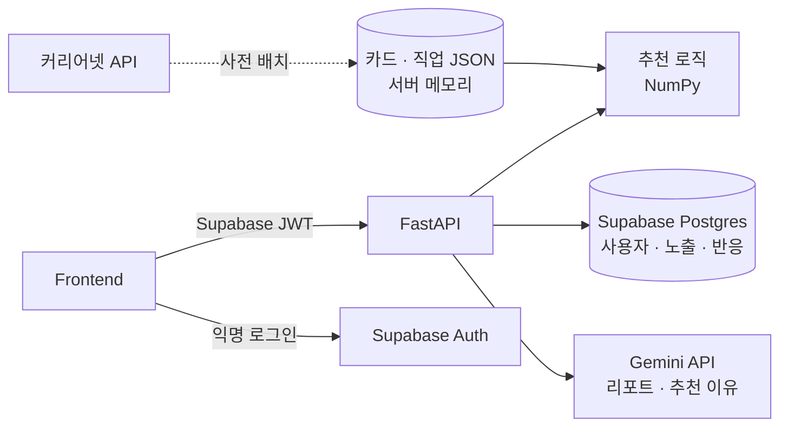

# WOOWANGTHON_TEAM_50_BE

**FIND-ME** 백엔드 — 진로를 정하지 못한 중학생이 하루 30초 카드 반응만으로 자기 진로 성향을 쌓아가는 AI 진로 탐색 서비스

> 2026 AI 우왕톤 · 주제 "AI는 동료가 될 수 있을까?" · 팀 50

---

## 1. 백엔드가 하는 일

| 기능 | 설명 |
|---|---|
| 카드 피드 | 사용자 성향 벡터와 가까운 카드를 추천하고, 일부는 의외의 분야로 섞어서 내려줌 |
| 반응 수집 | 좋아요 · 싫어요 · 저장 · 패스 · 선택지 고르기를 노출 로그와 함께 저장 |
| 성향 갱신 | 반응할 때마다 사용자 벡터를 갱신 |
| 성향 리포트 | 12개 축 점수와 LLM이 생성한 설명 문장 제공 |
| 웹 푸시 | 구독 정보 저장, "오늘의 카드" 알림 발송 |

로그인은 프론트에서 Supabase Auth(익명 로그인)로 처리하고, 백엔드는 요청에 담긴 Supabase JWT만 검증한다.

## 2. 기술 스택

| 영역 | 기술 |
|---|---|
| 프레임워크 | FastAPI, Pydantic |
| 추천 계산 | NumPy |
| DB · 인증 | Supabase (Postgres, 익명 로그인) |
| LLM | Gemini API (Flash) |
| 콘텐츠 원천 | 커리어넷 Open API (직업백과) |
| 웹 푸시 | pywebpush |
| 배포 | Render |

## 3. 구조



- **사용자가 만드는 데이터**(프로필, 노출, 반응, 푸시 구독)는 Supabase에 저장한다.
- **팀이 만드는 데이터**(차원 정의, 직업, 카드)는 레포의 JSON/CSV로 관리하고, 서버가 시작할 때 Pydantic으로 검증한 뒤 메모리에 올린다.
- 외부 API 키와 Supabase service role 키는 백엔드에만 둔다.

## 4. 추천 방식

카드와 사용자를 **같은 12차원 공간**의 벡터로 표현하고, 코사인 유사도로 가까운 카드를 고른다.

- **차원:** Holland RIASEC 흥미 6축 + 일하는 방식·가치관 6축. 정의는 [`backend/data/attributes.csv`](backend/data/attributes.csv), 태깅 기준은 [`docs/dimensions.md`](docs/dimensions.md)
- **카드 벡터:** 0~3 정수 루브릭으로 태깅. 카드당 0이 아닌 축 2~4개
- **사용자 벡터:** 반응 가중치를 곱해 지수이동평균으로 갱신. 선택형 카드는 고른 선택지의 벡터를 사용
- **탐색:** 노출 일부는 무작위 분야로 섞어 추천이 한쪽으로 좁아지는 것을 막음
- **콜드 스타트:** 첫 세션은 분야별로 고르게 샘플링

노출 로그에는 추천 출처(`personalized` / `random` / `cold_start`)를 함께 저장해 **맞춤 추천과 무작위 추천의 반응률을 비교**한다.

## 5. 디렉터리

```
.
├─ backend/
│  ├─ app/
│  │  ├─ main.py          # 앱 생성, 라우터 등록, 시작 시 콘텐츠 로드
│  │  ├─ core/            # 설정, Supabase JWT 검증
│  │  ├─ api/             # 라우터 (HTTP 계층)
│  │  ├─ content/         # 카드·직업 모델과 로더
│  │  ├─ recommend/       # 벡터 갱신, 랭킹 (DB·HTTP 의존 없음)
│  │  ├─ llm/             # Gemini 호출, 프롬프트
│  │  ├─ db/              # Supabase 접근
│  │  └─ schemas/         # API 요청/응답 모델
│  ├─ data/               # attributes.csv, jobs.json, cards.json
│  ├─ scripts/            # 커리어넷 수집, 카드 생성, 검수용 CSV 내보내기
│  ├─ tests/
│  ├─ .env.example
│  └─ requirements.txt
├─ supabase/migrations/   # DB 스키마
└─ docs/                  # 설계 문서
```

> 현재 `backend/data/attributes.csv`, `docs/dimensions.md`만 있고 나머지는 구현 예정.

## 6. API (초안)

| 메서드 | 경로 | 설명 |
|---|---|---|
| GET | `/health` | 헬스 체크 |
| GET | `/feed` | 다음에 보여줄 카드 목록 |
| POST | `/reactions` | 카드 반응 저장 + 성향 갱신 |
| GET | `/me` | 내 프로필과 현재 성향 |
| GET | `/me/report` | 성향 리포트 |
| POST | `/push/subscribe` | 웹 푸시 구독 등록 |

정확한 요청·응답 형식은 서버 실행 후 `/docs`(Swagger)를 기준으로 한다.

## 7. 실행 방법

> 구현 시작 후 확정

```bash
cd backend
python -m venv .venv
source .venv/bin/activate          # Windows: .venv\Scripts\activate
pip install -r requirements.txt
cp .env.example .env               # 값 채우기
uvicorn app.main:app --reload
```

### 환경 변수

| 이름 | 설명 |
|---|---|
| `SUPABASE_URL` | Supabase 프로젝트 URL |
| `SUPABASE_SERVICE_ROLE_KEY` | 서버 전용 키. 프론트·레포에 절대 노출 금지 |
| `SUPABASE_JWT_SECRET` | 프론트가 보낸 JWT 검증용 |
| `GEMINI_API_KEY` | Gemini API 키 |
| `CAREERNET_API_KEY` | 커리어넷 Open API 키 (배치 스크립트 전용) |
| `VAPID_PUBLIC_KEY` / `VAPID_PRIVATE_KEY` | 웹 푸시 서명 키 |
| `CORS_ORIGINS` | 허용할 프론트 주소 (쉼표 구분) |

`.env`는 `.gitignore`에 포함돼 있다. 키를 커밋하지 말 것.

## 8. 협업 규칙

- 커밋 메시지: `타입: 내용` (`feat`, `fix`, `docs`, `refactor`, `chore`, `test`)
- `main`에 직접 push하지 않고 기능 브랜치 → PR → 리뷰 1명 후 merge
- 카드 데이터(`backend/data/cards.json`) 수정도 PR로 올려 diff로 검수

## 9. AI 활용 및 구현 범위

대회 규정에 따라 최종 제출 전에 채운다.

- **AI가 하는 일:** 카드 콘텐츠 생성과 속성 태깅(사전 배치), 성향 리포트와 "왜 이 카드?" 설명 문장 생성(실시간)
- **AI가 하지 않는 일:** 추천 순위 결정. 순위는 벡터 유사도로 계산한다.
- **직접 구현 / 외부 기술:** TBD
- **미적용 · 미검증 부분:** TBD
- **데이터 출처:** 커리어넷 Open API
- **샘플 · 모킹 범위:** TBD

## 10. 팀

| 역할 | 담당 |
|---|---|
| BE 1 | API, DB, 반응 로그, 웹 푸시 |
| BE 2 | 추천 로직, LLM 콘텐츠·속성 생성 |
